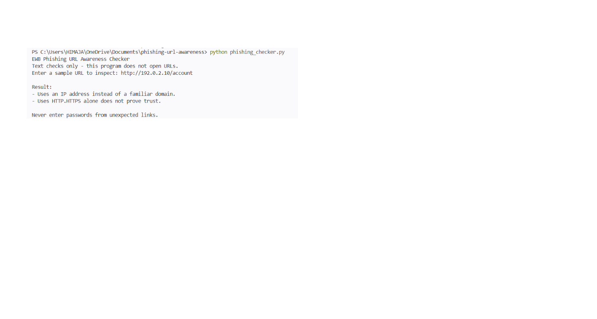
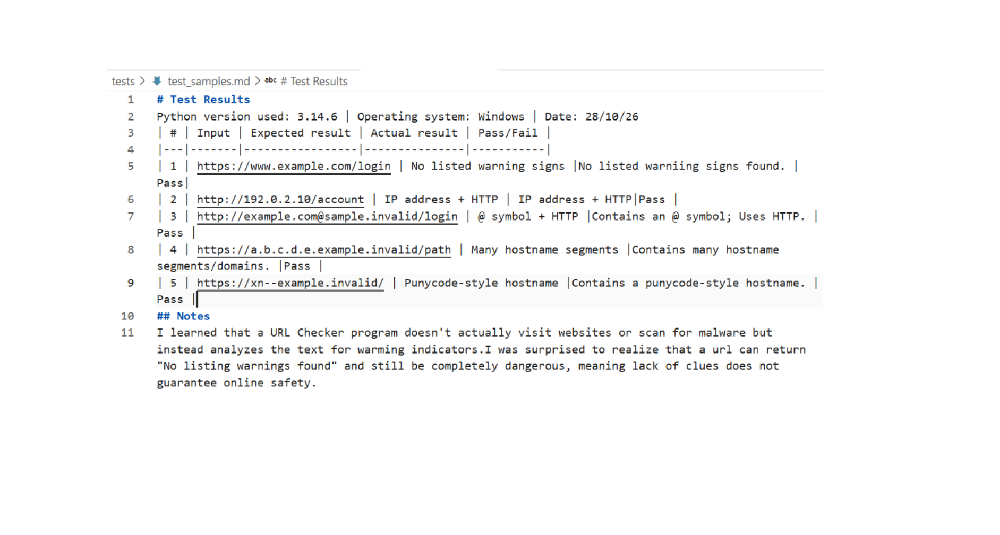

# EWB Phishing URL Awareness Checker
## Overview
1.Phishing is a deceptive social engineering attack where cybercriminals send fake messages designated to trick the people into giving away their sensitive information.
2.The URL Checker tool analyzes text structure locally and flags six warning indicators.
3.The six warning indicators are 
• @ symbol
• Very long URL 
• IP address hostname
• Many hostname segments
• Punycode marker
• HTTP connection
## Features
- Detects an @ symbol in the URL
- Flags unusually long URLs (over 100 characters)
- Flags IP-address hostnames
- Flags many hostname segments (5 or more)
- Flags punycode-style hostnames (xn--)
- Flags the HTTP scheme
- Generates a clear "Review Carefully" summary alert when risk warning signs are found
- Sanitizes malformed input strings using exception handling to ensure zero terminal crashes
## Requirements
Python 3.10 or later. No extra packages.
## How to Run
Windows: python phishing_checker.py
Mac/Linux: python3 phishing_checker.py
## Example Output

## Testing
| # | Input | Expected result | Actual result | Pass/Fail |
|---|-------|-----------------|---------------|-----------|
| 1 | https://www.example.com/login | No listed warning signs |No listed warniing signs found. | Pass|
| 2 | http://192.0.2.10/account | IP address + HTTP | IP address + HTTP|Pass |
| 3 | http://example.com@sample.invalid/login | @ symbol + HTTP |Contains an @ symbol; Uses HTTP. |Pass |
| 4 | https://a.b.c.d.e.example.invalid/path | Many hostname segments |Contains many hostname segments/domains. |Pass |
| 5 | https://xn--example.invalid/ | Punycode-style hostname |Contains a punycode-style hostname. |Pass |
## Screenshots

## Improvements
1. **Review Carefully Summary** - Added a summary notice footer to the final output. This helps users quickly notice if any severe structural flags were caught without reading through the raw strings. Tested it by running a flagged URL (`http://192.0.2`) to verify the footer shows up, and a clean URL to ensure it stays hidden.
2. **Stop Crashes on Malformed Input** - Modified the URL parser function inside a try/except safety block targeting ValueErrors. This keeps the tool stable and running cleanly even if heavily corrupted text strings are input. Tested it by typing `http://[bad` into the prompt to confirm it displays a safety message instead of crashing the terminal.
## Limitations
This is an educational tool. It only reads URL text. It does not visit
URLs, scan for malware or prove that a URL is safe. No warning signs
found does NOT mean a URL is safe.
## Ethical Use
Use sample strings only. Do not collect credentials. Do not use this
project to deceive anyone or to test websites without permission.
## Author
KOLLI HIMAJA, AI POWERED CYBERSECURITY, EWB Courses
